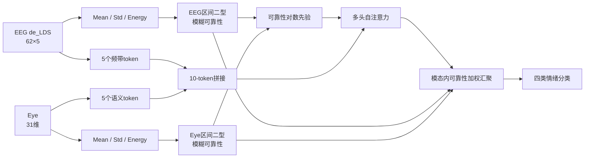
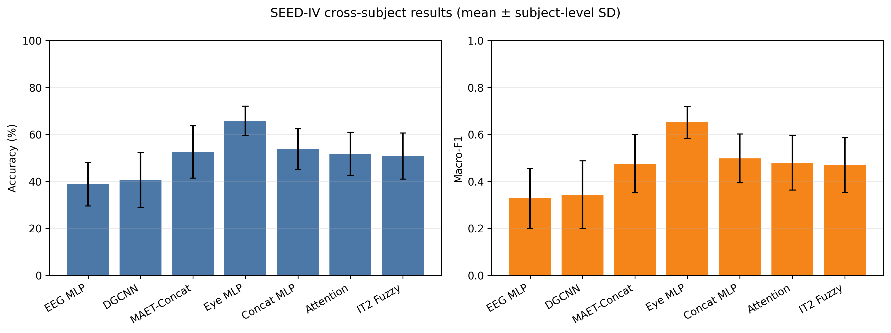
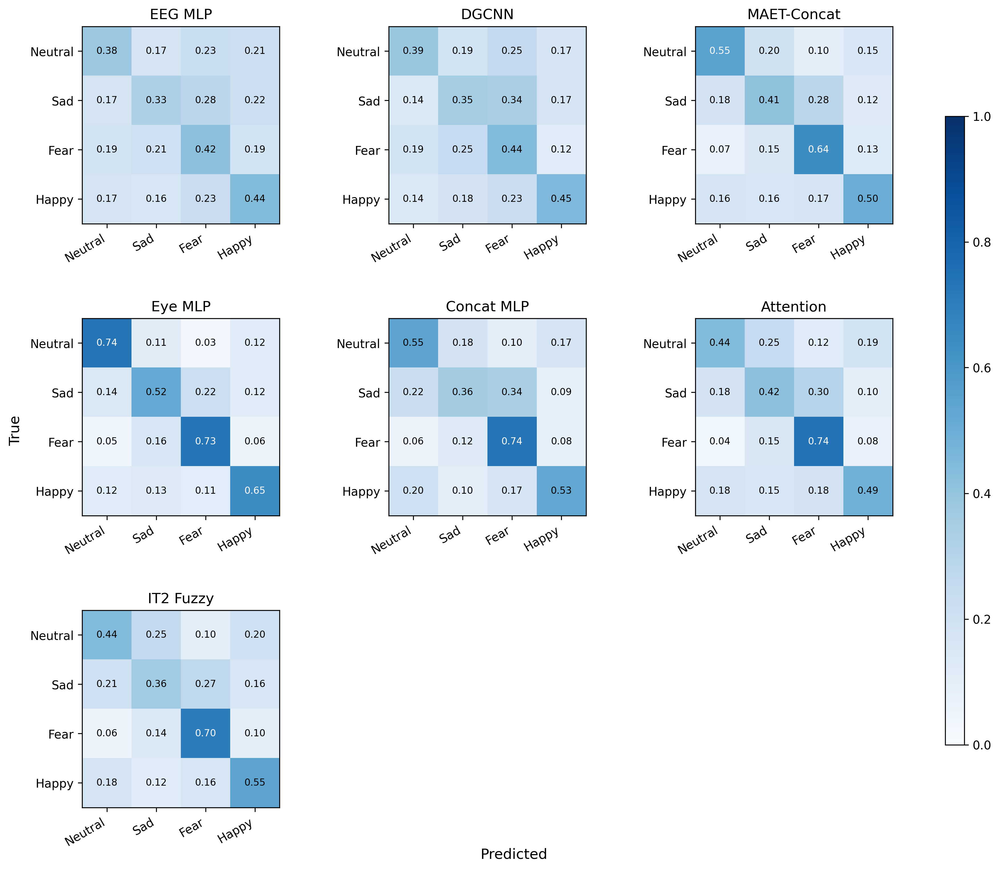

# 跨被试EEG–眼动情绪识别中的多模态负迁移：统一评测与可靠性融合分析

> 初稿状态说明：本文档中的主结果均来自完整15折正式实验；每名被试恰好
> 测试一次。结果不支持将区间二型可靠性模块表述为性能提升方法，因此本文
> 如实转向多模态负迁移实证与可靠性融合分析。
>
> 方法来源说明：Mean/Std/Energy与区间二型高斯加权参考Tang等的
> IT2-GaussFormer[8]，类型约简参考Karnik–Mendel方法[6-7]。本文研究的是
> 该类可靠性建模向EEG频带token、眼动语义token和跨被试多模态联合注意力的
> 适配与评测，不主张上述基础模块为本文首创。

## 摘要

跨被试情绪识别受到个体生理差异和模态稳定性不一致的影响，多模态融合因而
不一定优于稳定的单一模态。为考察该问题，本文在SEED-IV上建立严格的15折
跨被试协议：每折使用13名被试训练、1名被试验证和1名被试测试，并且仅使用
训练被试统计量进行标准化。在统一训练和模型选择条件下，本文比较EEG MLP、
DGCNN、眼动MLP、特征拼接、MAET、普通注意力及区间二型模糊可靠性注意力。
其中，可靠性模型将EEG差分熵特征构造成5个频带token，将31维眼动特征划分为
5个语义token，并根据平均绝对值、标准差和能量估计可靠性区间，将其用于
注意力偏置和加权汇聚。完整15折结果显示，Eye MLP取得最高Accuracy
（65.80%±6.24%）和Macro-F1（0.6515±0.0685）；Concat MLP、普通Attention
和区间二型可靠性模型的Macro-F1分别为0.4975、0.4800和0.4690。逐被试配对
检验表明，Eye MLP相对三种多模态融合模型的优势在Holm校正后仍显著
（均 \(p<0.01\)）；区间二型模型与普通Attention的差异不显著
（校正后 \(p=1.0\)）。结果说明，在严格未知被试条件下，不稳定EEG表征可能
导致显著的多模态负迁移，而仅依赖输入统计量的可靠性先验不足以缓解该问题。
本文为跨被试多模态情绪识别的无泄漏评测和失败机制分析提供实验依据。

**关键词：** 情绪识别；脑电；眼动；跨被试；区间二型模糊系统；多模态融合

## 1 引言

情绪状态影响人的认知、决策和交互行为。基于生理信号的情绪识别能够减少
语言和表情刻意掩饰带来的影响，在人机交互、心理状态监测和辅助诊疗等场景
中具有研究价值。脑电（electroencephalography，EEG）直接记录大脑电活动，
具有较高的时间分辨率；眼动则从瞳孔、注视和扫视等行为反映视觉加工与唤醒
水平。因此，融合EEG和眼动信号有望获得比单一模态更完整的情绪表征。

现有研究在被试混合或被试内划分下取得了较好结果，但模型部署时通常需要
面对训练阶段未见的新被试。不同被试的脑区响应、信号幅值、伪迹和基线状态
存在差异，导致训练分布与测试分布不一致。若随机划分样本，同一被试的数据
可能同时进入训练集和测试集，从而高估模型的泛化能力。因此，跨被试实验
应当隔离训练、验证和测试被试，并避免使用测试被试统计量进行标准化或模型
选择。

多模态融合并不必然提升跨被试性能。当EEG在某个未知被试上发生明显漂移时，
简单拼接仍会把该模态作为稳定信息输入分类器；普通注意力虽然能够学习token
之间的相关性，但注意力权重主要表示任务相关的重要程度，不能直接等同于
可靠性或不确定性。如何在融合过程中显式表示不同token的可靠性范围，是本文
关注的问题。

区间二型模糊集合通过上下隶属函数描述隶属度的不确定区间，可用于处理个体
差异、测量噪声和边界模糊等问题。已有IT2-GaussFormer使用均值、标准差和
能量统计量对医学时间序列的局部尺度进行区间二型模糊加权[8]。本文不把这一
统计量组合本身作为原创点，而是面向EEG–眼动跨被试融合，将其改造为模态内
token可靠性估计，并检验所得先验能否改善联合注意力。本文的主要工作如下：

1. 建立统一、可复现且无测试泄漏的SEED-IV跨被试评测流程，以13/1/1被试
   划分完成15折轮换测试。
2. 在统一协议下系统比较单模态、图模型、特征拼接和注意力融合，发现稳定的
   Eye-only模型显著优于多种EEG–眼动融合模型，量化跨被试负迁移。
3. 将区间二型高斯模糊加权适配到异构EEG–眼动token，并通过普通Attention
   对照证实该可靠性先验未产生显著改善，为后续域级可靠性研究提供失败证据。

## 2 相关工作

### 2.1 EEG与眼动多模态情绪识别

SEED-IV同时提供EEG和眼动特征，为四类情绪识别研究提供了常用基准[1]。
早期研究已比较EEG、眼动及特征级和决策级融合[2]。后续方法进一步使用
同质编码空间对齐[3]、跨模态可信度建模[9]和Transformer跨模态迁移[10]。
特征拼接实现简单，但假设所有模态在不同样本和不同被试上都具有稳定贡献；
深度融合方法能够刻画非线性关系，但若实验划分没有严格隔离被试，其结果不能
代表未知被试上的泛化能力。

### 2.2 跨被试情绪识别

跨被试研究通常采用留一被试、域适应或域泛化方法减小个体差异。Zhu等使用
多维同质编码空间处理跨被试和跨会话场景[3]；另一项工作结合动态对抗域适应、
自注意力、交叉注意力和对比损失学习被试无关的多模态表示[4]。域适应方法
可能使用目标域无标签数据，而完全未知被试场景更强调不访问测试域数据的
泛化能力。本文不使用测试被试数据训练域适配器，而是研究在固定特征和严格
被试隔离条件下，可靠性引导融合能否改善模型表现。

### 2.3 模糊不确定性建模

一型模糊系统为输入分配确定隶属度；区间二型模糊系统进一步使用隶属度上下界
描述不确定足迹，并通过类型约简得到输出区间[5-7]。Herman等将区间二型模糊
系统用于运动想象EEG分类，以处理脑电的非平稳性[5]。Tang等提出
IT2-GaussFormer，根据均值、标准差和能量统计量估计医学时间序列局部片段的
模糊权重[8]。与其面向单一时间序列的多尺度局部片段不同，本文处理同步EEG
频带token和具有不同维数的眼动语义token，并把模态内可靠性作为跨模态联合
注意力的先验。本文不把注意力权重解释为不确定性本身，而是使用独立模糊模块
产生可靠性估计。

## 3 方法

本文方法的总体流程如图1所示。

**图1  区间二型模糊可靠性引导的EEG–眼动融合流程**

### 3.1 问题定义

设第 \(i\) 个四秒窗口的EEG差分熵特征为
\(\mathbf{X}^{e}_i\in\mathbb{R}^{62\times5}\)，其中62为电极数、5为频带数；
眼动特征为 \(\mathbf{x}^{o}_i\in\mathbb{R}^{31}\)，标签
\(y_i\in\{0,1,2,3\}\) 分别对应中性、悲伤、恐惧和高兴。模型学习映射

\[
\hat{\mathbf{y}}_i=f_\theta(\mathbf{X}^{e}_i,\mathbf{x}^{o}_i),
\]

并在训练阶段未见的测试被试上进行预测。

### 3.2 多模态token构造

对EEG的5个频带分别取62维通道向量，经共享线性投影、层归一化和GELU激活，
得到5个 \(d\) 维EEG token。眼动特征按照原始特征语义划分为瞳孔直径
（12维）、离散度（4维）、注视时长（2维）、扫视（4维）和事件统计
（9维）5组，各组通过独立投影得到5个眼动token。加入可学习的token嵌入后，
将两种模态拼接为

\[
\mathbf{H}_0=[\mathbf{H}^{e};\mathbf{H}^{o}]
\in\mathbb{R}^{10\times d}.
\]

本文设置 \(d=64\)，注意力头数为4，前馈网络维数为128。

### 3.3 区间二型模糊可靠性估计

对每个原始token组 \(\mathbf{x}_t\) 计算三个统计量：

\[
z_{t,1}=\frac{1}{D_t}\sum_{k=1}^{D_t}|x_{t,k}|,\quad
z_{t,2}=\operatorname{Std}(\mathbf{x}_t),\quad
z_{t,3}=\frac{1}{D_t}\sum_{k=1}^{D_t}x_{t,k}^{2}.
\]

三个统计量分别表示幅值、离散程度和能量。为降低不同统计量尺度的影响，
在每种模态的5个token之间执行样本级最小–最大归一化。对于第 \(r\) 条规则
和第 \(q\) 个统计量，使用具有可学习中心、尺度及其扰动范围的两个高斯函数：

\[
\mu^{(a)}_{q,r}(z)=
\exp\left[-\frac{1}{2}
\left(\frac{z-(c_{q,r}-\Delta c_{q,r})}
{\sigma_{q,r}-\Delta\sigma_{q,r}}\right)^2\right],
\]

\[
\mu^{(b)}_{q,r}(z)=
\exp\left[-\frac{1}{2}
\left(\frac{z-(c_{q,r}+\Delta c_{q,r})}
{\sigma_{q,r}+\Delta\sigma_{q,r}}\right)^2\right].
\]

上下隶属度取两者的最小值和最大值：

\[
\underline{\mu}_{q,r}=\min(\mu^{(a)}_{q,r},\mu^{(b)}_{q,r}),\qquad
\overline{\mu}_{q,r}=\max(\mu^{(a)}_{q,r},\mu^{(b)}_{q,r}).
\]

第 \(r\) 条规则的激活区间通过三个前件隶属度的乘积获得：

\[
\underline{w}_{t,r}=\prod_{q=1}^{3}\underline{\mu}_{q,r},\qquad
\overline{w}_{t,r}=\prod_{q=1}^{3}\overline{\mu}_{q,r}.
\]

本文使用8条规则和可学习后件，通过Karnik–Mendel型迭代约简得到token输出区间
\([\underline{g}_t,\overline{g}_t]\)。定义区间中点和宽度为

\[
m_t=\frac{\underline{g}_t+\overline{g}_t}{2},\qquad
u_t=\overline{g}_t-\underline{g}_t.
\]

最终可靠性权重为

\[
r_t=\operatorname{softmax}_t(m_t-\lambda u_t),
\]

其中 \(\lambda=1\) 为不确定性惩罚系数。EEG和眼动模态分别归一化，以避免
token数量给某一模态带来先验偏置。

### 3.4 可靠性引导注意力与分类

在多头自注意力中，将可靠性作为键方向的对数先验加入注意力logit：

\[
\mathbf{A}=
\operatorname{softmax}\left(
\frac{\mathbf{Q}\mathbf{K}^{\mathsf T}}{\sqrt{d_h}}
+\log(\mathbf{r}+\varepsilon)
\right).
\]

注意力输出经过残差连接、层归一化和前馈网络。随后，EEG和眼动token分别使用
各自可靠性权重加权求和：

\[
\mathbf{h}^{e}=\sum_{t=1}^{5}r^{e}_t\mathbf{H}^{e}_t,\qquad
\mathbf{h}^{o}=\sum_{t=1}^{5}r^{o}_t\mathbf{H}^{o}_t.
\]

拼接两个模态表示，经两层分类器输出四类logit。普通Attention消融使用完全
相同的token投影、注意力块和分类器，但不使用模糊可靠性先验，并以均值完成
模态内汇聚。

### 3.5 训练目标

模型以带类别权重和标签平滑的交叉熵进行训练：

\[
\mathcal{L}=-\sum_{c=1}^{4}\alpha_c\tilde{y}_c
\log p_c,
\]

其中类别权重 \(\alpha_c\) 只由当前折训练集计算，标签平滑系数为0.05。

## 4 实验

### 4.1 数据集与评测协议

SEED-IV包含15名被试、3次实验会话，每次会话观看24段情绪电影片段。本文使用
官方平滑差分熵特征 `de_LDS` 和31维眼动特征，共得到37,575个对齐的四秒窗口，
每名被试2,505个窗口。

本文构造15个确定性跨被试折。第 \(k\) 折以第 \(k\) 名被试为测试集、循环后的
下一名被试为验证集，其余13名被试为训练集。每名被试恰好测试一次和验证一次。
EEG与眼动的均值、标准差及缺失值填充值均只根据13名训练被试估计。验证集用于
早停和checkpoint选择，测试集不参与超参数选择。

### 4.2 实现细节

所有神经网络采用PyTorch实现，固定随机种子为0。优化器为AdamW，权重衰减
为0.001，最大学习率为 \(3\times10^{-4}\)。学习率使用OneCycle策略，最多
训练50轮，若验证Macro-F1连续10轮未改善则提前停止，梯度范数裁剪为1.0。
训练和测试批量分别为64和128。主指标为逐被试Accuracy和Macro-F1的均值及
样本标准差，同时报告逐类Precision、Recall、F1和混淆矩阵。

### 4.3 对比方法

- **EEG MLP：** 将 \(62\times5\) EEG特征展平后输入两层MLP。
- **Eye MLP：** 仅使用31维眼动特征。
- **Concat MLP：** 分别编码EEG和眼动特征后拼接分类。
- **DGCNN：** 使用EEG电极图结构的深度基线。
- **MAET-Concat：** 将已有多模态自适应Transformer适配为SEED-IV的31维眼动
  输入和四分类输出[11]，本实验不使用域对抗分支。
- **Attention：** 不含模糊可靠性模块的多模态注意力消融。
- **IT2 Fuzzy Attention：** 本文适配并评测的完整可靠性引导模型。

### 4.4 主结果

表1给出严格13/1/1协议下15名测试被试的平均结果。

**表1  SEED-IV跨被试四分类结果（均值±样本标准差）**

| 模型 | 输入模态 | Accuracy/% | Macro-F1 |
|---|---|---:|---:|
| EEG MLP | EEG | 38.72 ± 9.20 | 0.3275 ± 0.1282 |
| DGCNN | EEG | 40.53 ± 11.64 | 0.3432 ± 0.1439 |
| MAET-Concat | EEG+Eye | 52.54 ± 11.14 | 0.4753 ± 0.1242 |
| Eye MLP | Eye | 65.80 ± 6.24 | 0.6515 ± 0.0685 |
| Concat MLP | EEG+Eye | 53.74 ± 8.70 | 0.4975 ± 0.1040 |
| Attention | EEG+Eye | 51.72 ± 9.21 | 0.4800 ± 0.1168 |
| IT2 Fuzzy Attention | EEG+Eye | 50.78 ± 9.84 | 0.4690 ± 0.1165 |

**图2  各模型跨被试结果（误差线为15名测试被试的样本标准差）**

现有完整结果显示，EEG MLP和DGCNN的Macro-F1分别为0.3275和0.3432，说明在
未知被试上，仅增加EEG模型的结构复杂度并未消除明显的个体差异。Eye MLP的
Macro-F1达到0.6515，且逐被试标准差为0.0685，明显高于两个EEG基线并具有更小
的被试间波动。这一结果说明，在本文的特征和划分下，眼动是更稳定的跨被试
模态。Concat MLP的Macro-F1为0.4975，低于Eye MLP的0.6515，表明简单加入EEG
并未带来互补收益，反而出现明显的跨模态负迁移。普通Attention的Macro-F1为
0.4800，亦未缓解该问题，说明在当前结构和协议下，仅学习token相关性不能保证
获得可靠的跨被试融合。IT2 Fuzzy Attention的Macro-F1进一步降至0.4690，
表明基于单窗口幅值、标准差和能量的可靠性先验同样没有解决跨被试模态失配。

以测试被试为配对单位，Eye MLP相对Concat MLP、Attention和MAET-Concat的
Macro-F1均值优势分别为0.1539、0.1715和0.1762，95% bootstrap置信区间均不
跨越0；在每个指标的7项预设比较上统一进行Holm校正后，三项比较的
\(p\)值分别为0.0021、0.0070和0.0070。该结果支持本文观察到的负迁移不是
由少数单一被试造成。IT2相对Attention的Macro-F1均值差为−0.0110，
95%置信区间为[−0.0478, 0.0260]，校正后 \(p=1.0\)，因此只能得出“未观察到
改善”，不能声称其显著劣于普通Attention。

### 4.5 逐类结果与混淆矩阵

表2给出表现最好的Eye MLP与IT2模型在全部37,575个测试窗口上的池化逐类指标。
该口径用于逐类分析，不与表1的逐被试Macro-F1均值混写。

**表2  Eye MLP与IT2模型的池化逐类结果**

| 模型 | 类别 | Precision | Recall | F1 | Support |
|---|---|---:|---:|---:|---:|
| Eye MLP | neutral | 0.7258 | 0.7378 | 0.7317 | 10,170 |
| Eye MLP | sad | 0.5937 | 0.5205 | 0.5547 | 10,245 |
| Eye MLP | fear | 0.6656 | 0.7314 | 0.6970 | 9,225 |
| Eye MLP | happy | 0.6335 | 0.6481 | 0.6408 | 7,935 |
| IT2 Fuzzy Attention | neutral | 0.5275 | 0.4444 | 0.4824 | 10,170 |
| IT2 Fuzzy Attention | sad | 0.4394 | 0.3650 | 0.3987 | 10,245 |
| IT2 Fuzzy Attention | fear | 0.5595 | 0.7038 | 0.6234 | 9,225 |
| IT2 Fuzzy Attention | happy | 0.4868 | 0.5454 | 0.5144 | 7,935 |

**图3  各模型在37,575个测试窗口上的池化归一化混淆矩阵**

Eye MLP四类F1均高于IT2模型。两者对fear类别的召回率相对较高，而sad类别
均最难识别；IT2模型还将较多sad样本误分为fear。这说明融合模型的整体下降
并非只来自一个类别，而是同时影响neutral、sad和happy。

### 4.6 消融与可靠性分析

普通Attention与IT2模型使用相同的token投影、注意力层数、分类器和训练设置，
差别是后者在注意力logit和模态内汇聚中加入模糊可靠性。IT2相对Attention的
Accuracy差为−0.94个百分点，Macro-F1差为−0.0110，两项差异的95%置信区间
均跨越0，Holm校正后均不显著。因此，实验没有证据表明完整可靠性引导模块
有效，也不能进一步归因于其中某个使用位置。为避免根据测试结果反复调参，
本文不再追加改变 \(\lambda\) 或规则数的事后搜索。

## 5 讨论

本文首先强调跨被试多模态融合的评测问题。不同实验划分、标准化范围和模型
选择方式会显著影响结果，因而被试混合划分、14/1留一被试划分与本文13/1/1
结果不能直接比较。本文的独立验证被试避免了使用测试被试进行早停，但也减少
了每折可用于训练的被试数量。

结果显示，当前多模态模型均未超过Eye-only。一个可能原因是，EEG的跨被试
偏移主要表现为域级结构变化，而本文可靠性模块只根据单个窗口内部5个token的
相对统计量赋权。幅值、标准差和能量能够描述局部数值特征，却未必能区分
“情绪相关变化”和“被试特异偏移”。此外，可靠性同时影响注意力和汇聚，
若估计本身存在偏差，误差也可能被重复放大。

这一负结果并不否定EEG与眼动在被试内或允许目标域适应条件下的互补性，而是
说明融合收益依赖评测场景和可靠性估计尺度。在完全不访问测试被试数据的设置
下，先保证单模态跨域稳定性，再进行门控或融合，可能比直接联合编码更重要。
后续研究可在不使用测试标签的前提下，利用训练域间一致性、域级校准或显式
域泛化目标学习可靠性，而不应仅把注意力权重解释为可信度。

本文仍有以下局限。第一，目前只在SEED-IV及固定随机种子上验证，尚不能证明
对其他数据集和初始化均稳定。第二，可靠性由三个统计量间接估计，不等同于
传感器层面的真实信号质量。第三，眼动分组依据官方特征含义设置，仍带有先验
设计。第四，本文不使用测试域数据，因此结果不能与允许目标域自适应的方法
作完全等价比较。

## 6 结论

本文在严格13/1/1被试隔离协议下系统评测SEED-IV跨被试EEG–眼动情绪识别。
15折结果表明，Eye MLP的均值高于EEG单模态，并显著优于特征拼接、MAET和
注意力融合，揭示当前EEG表征在未知被试上可能引起多模态负迁移。本文进一步
将区间二型模糊可靠性先验用于联合注意力和模态内汇聚，但其Macro-F1未显著
优于结构一致
的普通Attention，并显著低于Eye-only。由此可见，局部统计量驱动的可靠性
加权不足以替代跨被试域稳定性建模。本文的主要价值在于提供统一无泄漏评测、
完整负结果和可复现对照，为后续跨被试多模态融合方法的设计与评价提供依据。

## 参考文献

> 以下条目已按原始论文页或DOI核对基本信息，定稿时再转换为目标期刊格式。

[1] ZHENG W L, LIU W, LU Y, et al. EmotionMeter: A multimodal framework
for recognizing human emotions[J]. IEEE Transactions on Cybernetics, 2019,
49(3): 1110-1122. DOI: 10.1109/TCYB.2018.2797176.

[2] ZHENG W L, DONG B N, LU B L. Multimodal emotion recognition using EEG
and eye tracking data[C]//2014 36th Annual International Conference of the
IEEE Engineering in Medicine and Biology Society. 2014: 5040-5043.
DOI: 10.1109/EMBC.2014.6944757.

[3] ZHU M, WU Q, BAI Z, et al. EEG-eye movement based subject dependence,
cross-subject, and cross-session emotion recognition with multidimensional
homogeneous encoding space alignment[J]. Expert Systems with Applications,
2024, 251: 124001. DOI: 10.1016/j.eswa.2024.124001.

[4] ZHU Q, ZHU T, FEI L, et al. Multi-modal cross-subject emotion feature
alignment and recognition with EEG and eye movements[J]. IEEE Transactions
on Affective Computing, 2025, 16(3): 2102-2115.
DOI: 10.1109/TAFFC.2025.3554399.

[5] HERMAN P A, PRASAD G, MCGINNITY T M. Designing an interval type-2
fuzzy logic system for handling uncertainty effects in brain-computer
interface classification of motor imagery induced EEG patterns[J]. IEEE
Transactions on Fuzzy Systems, 2017, 25(1): 29-42.
DOI: 10.1109/TFUZZ.2016.2637934.

[6] KARNIK N N, MENDEL J M, LIANG Q. Type-2 fuzzy logic systems[J]. IEEE
Transactions on Fuzzy Systems, 1999, 7(6): 643-658.
DOI: 10.1109/91.811231.

[7] KARNIK N N, MENDEL J M. Centroid of a type-2 fuzzy set[J]. Information
Sciences, 2001, 132(1-4): 195-220.
DOI: 10.1016/S0020-0255(01)00069-X.

[8] TANG C, TANG Y K, MO H. IT2-GaussFormer: An interval type-2 Gaussian
fuzzy transformer for medical time-series classification[J]. Biomedical
Signal Processing and Control, 2026, 125: 110804.
DOI: 10.1016/j.bspc.2026.110804.

[9] ZHANG Y, LIU H, WANG D, et al. Cross-modal credibility modelling for
EEG-based multimodal emotion recognition[J]. Journal of Neural Engineering,
2024, 21(2): 026040. DOI: 10.1088/1741-2552/ad3987.

[10] JIANG W B, LI Z, ZHENG W L, et al. Functional emotion transformer for
EEG-assisted cross-modal emotion recognition[C]//ICASSP 2024. 2024:
1841-1845. DOI: 10.1109/ICASSP48485.2024.10446937.

[11] JIANG W B, LIU X H, ZHENG W L, et al. Multimodal adaptive emotion
transformer with flexible modality inputs on a novel dataset with continuous
labels[C]//Proceedings of the 31st ACM International Conference on Multimedia.
2023: 5975-5984. DOI: 10.1145/3581783.3613797.

## 给导师的说明（不属于论文正文）

老师您好，我将小论文收束为SEED-IV严格跨被试EEG–眼动情绪识别，并完成了
7种模型的统一15折实验。结果显示Eye-only的Macro-F1为0.6515，显著高于
Concat、MAET和普通Attention；区间二型可靠性模型为0.4690，未显著优于普通
Attention。因此我没有把负结果包装成“方法有效”，而是将论文调整为多模态
负迁移实证与可靠性融合分析。附件是完整初稿、逐被试统计和混淆矩阵。想请您
重点判断：（1）这一实证分析是否适合作为小论文主线；（2）是否需要补充一种
域泛化基线；（3）目标国内期刊和格式要求应如何确定。
